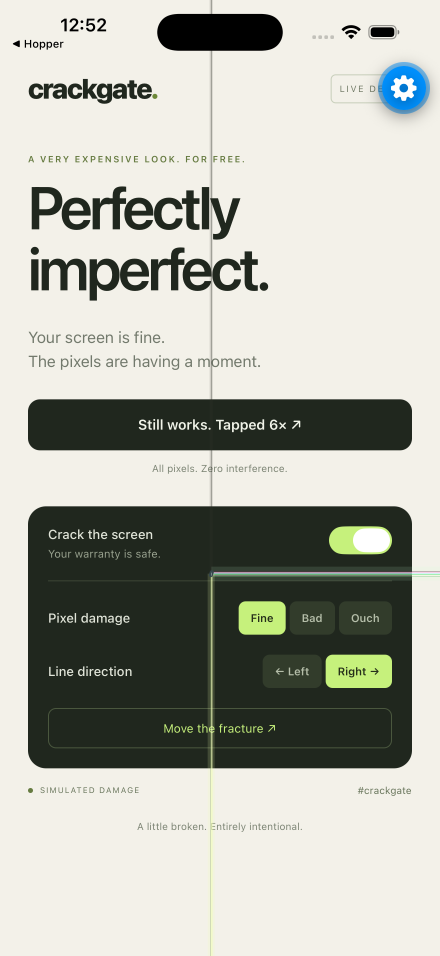
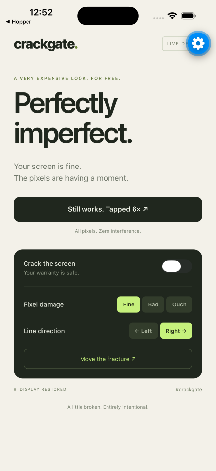
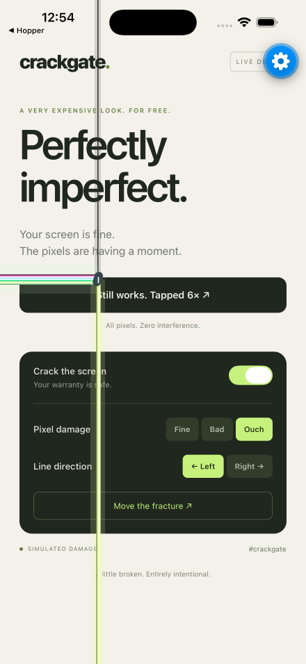
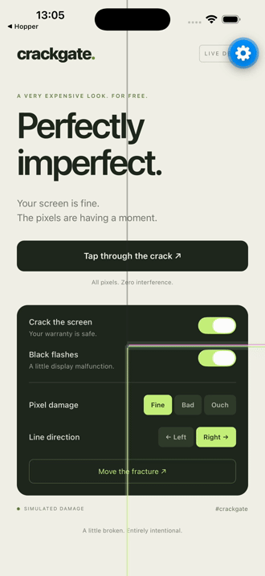

# react-native-crackgate

A fullscreen cracked-display effect for React Native, inspired by **#crackgate**: a dark vertical seam,
a pin-sized junction, pink/white/green horizontal pixel lines, and a pale yellow
line running to the bottom edge. Built with React Native views, with no additional
runtime dependencies, images, or native modules. Optional black flashes reproduce
the brief panel dropouts in [Expo’s video](https://x.com/expo/status/2115420818591097162).

## iOS example

Actual screenshots from the fullscreen Expo example on iPhone 17 Pro Max
(iOS 26.5). The crack is fixed over the entire app, including the controls;
content scrolls underneath it. The blue gear is Expo Go’s developer menu.

<p>
  
  
  
</p>

### Black flash

The same fullscreen demo with `flash: true`, captured on the iOS simulator:



## Usage

```tsx
import { CrackgateView } from 'react-native-crackgate';

export default function App() {
  return (
    <CrackgateView style={{ flex: 1 }} effect={{ flash: true }}>
      <YourApp />
    </CrackgateView>
  );
}
```

Wrap your app root as shown above for the fullscreen effect. Keep safe-area
padding inside the wrapper so the crack can reach the screen edges.

The wrapper clips damage to its bounds, including rounded corners. The overlay
ignores touches and is hidden from screen readers; the content stays interactive.
It adapts to its container when resized or rotated.

For an existing layout, render `Crackgate` as the **last child** of a positioned
view with a nonzero size:

```tsx
import { View } from 'react-native';
import { Crackgate } from 'react-native-crackgate';

<View style={{ flex: 1, position: 'relative' }}>
  <YourScreen />
  <Crackgate
    origin={{ x: 0.48, y: 0.6 }}
    intensity={1}
    thickness={1}
    direction="right"
  />
</View>;
```

`CrackgateView` accepts standard `ViewProps` and an `effect` object containing
the same options as `Crackgate`:

- `enabled` (default `true`): unmounts the overlay when false.
- `origin` (default `{ x: 0.48, y: 0.6 }`): junction coordinates relative to the
  container, measured from the top left; each is clamped to 0–1.
- `intensity` (default `1`): overall opacity, clamped to 0–1; zero renders nothing.
- `thickness` (default `1`): line and junction scale, clamped to 0.25–4.
- `direction` (default `'right'`): horizontal streaks extend to the left or right edge.
- `flash` (default `false`): briefly dims/blacks out the side selected by
  `direction`, from the seam to the screen edge, while leaving the colored lines
  visible. A short burst repeats every 3.6 seconds. Uses the native animation
  driver on iOS/Android, pauses in the background, and stays off with Reduce Motion
  enabled. Turning off the crack or setting intensity to zero also stops flashes.
- `testID`: optional identifier for the overlay.

Non-finite numeric values fall back to their defaults. Coordinates are physical
left/right and do not mirror in RTL. The effect covers its parent only: native
modals, system status/navigation bars, and content in another native window need
their own overlay. Give the wrapper a size or content that determines its size;
it does not impose `flex: 1`.

## Try the example

Scaffolded with [Bob](https://oss.callstack.com/react-native-builder-bob/create),
using TypeScript and an Expo example for iOS, Android, and web. The example lets
you enable/disable the effect and black flashes, move the junction, change thickness, mirror the
horizontal streaks, and tap through the damage.

```sh
corepack yarn install
corepack yarn example start     # Expo dev server / QR code
corepack yarn example ios       # iOS simulator with Expo Go
corepack yarn example android   # Android emulator with Expo Go
corepack yarn example web       # Browser
```

See [verification notes](docs/TESTING.md) for simulator checks and local run details.

## Build and check

```sh
corepack yarn typecheck
corepack yarn lint
corepack yarn prepare           # Bob: ES modules + TypeScript declarations
corepack yarn example build:web
corepack yarn pack --out /tmp/react-native-crackgate.tgz
```

The source is available on GitHub; the package has not been published to npm. Install the generated
tarball in another app to try it. React and React Native are peer dependencies.

MIT © Xavier Seignard
